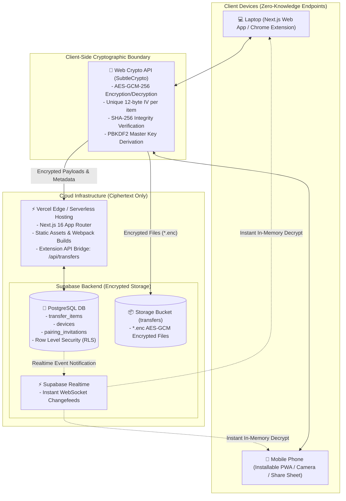
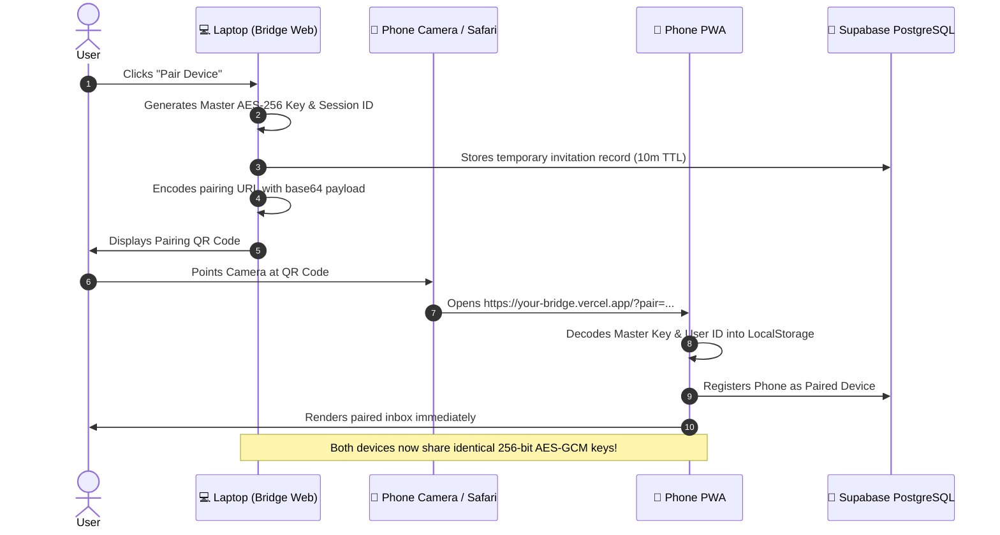
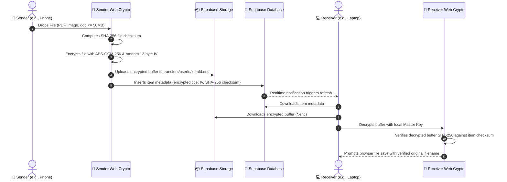

# Bridge 🌉
### Instant Cross-Device Personal Transfer & Universal Clipboard

Bridge is a high-speed, private, zero-knowledge personal transfer service designed to eliminate the friction of emailing yourself links, keeping messaging drafts, or texting yourself across devices. It seamlessly links your **Windows/Mac laptop** and **iOS/Android phone** with end-to-end encryption (AES-GCM-256), real-time synchronization, a Chrome browser extension, and an installable Progressive Web App (PWA).

---

## 🏗️ System Architecture & Data Flow



---

## 🔄 End-to-End Workflows

### 1. Zero-Friction 1-Tap Device Pairing Flow
Device pairing exchanges the 256-bit AES master key directly between your devices without any intermediary server ever knowing the plaintext key.



---

### 2. End-to-End Encrypted File Transfer Flow



---

## 🚀 Core Features & Usage

| Feature | Description | Shortcut / Access |
| :--- | :--- | :--- |
| **Instant URL Pushing** | Send any browser tab from your PC to your phone in one keystroke. | `Alt + Shift + B` (PC) |
| **Universal Clipboard** | Push prompts, tokens, code snippets, and formatted text directly to your mobile clipboard. | Composer &rarr; "Note / Snippet" |
| **Encrypted File Transfer** | Transfer documents, images, and files up to 50MB with client-side AES-GCM encryption and SHA-256 validation. | Drag & Drop / File Picker |
| **Chrome Companion** | Manifest V3 extension featuring 1-click tab send, selected text push, and configurable server endpoint. | Chrome Toolbar Icon |
| **Mobile PWA** | Native-feeling standalone app for iOS and Android with no app store download required. | "Add to Home Screen" |
| **Web Share Target** | Send articles, URLs, or files directly into Bridge from Twitter, Reddit, Safari, or Chrome on your phone. | Mobile System Share Sheet (`⎋`) |
| **Zero-Knowledge Security** | Client-side encryption ensures neither Supabase, Vercel, nor network sniffers can view your data. | Web Crypto API (AES-GCM) |
| **Device Revocation** | Instantly unlink lost or old devices from your account with 1 click. | Navbar &rarr; Devices Modal |

---

## 🛠️ Technology Stack

- **Frontend Framework:** [Next.js](https://nextjs.org/) (App Router, React 19, TypeScript)
- **Styling & UI:** [Tailwind CSS](https://tailwindcss.com/) v3.4, PostCSS, [Lucide Icons](https://lucide.dev/)
- **Cryptography:** Native Web Crypto API (`globalThis.crypto.subtle`)
  - 256-bit AES-GCM symmetric encryption
  - 96-bit (12-byte) cryptographically random IVs
  - SHA-256 cryptographic digest integrity validation
  - PBKDF2 key derivation (100,000 iterations)
- **Cloud Backend:** [Supabase](https://supabase.com/)
  - PostgreSQL with Row Level Security (RLS)
  - Realtime WebSocket publication channels
  - Encrypted Storage buckets (`transfers`)
- **Hosting & CI/CD:** [Vercel](https://vercel.com/) (Edge Network & Serverless Functions)
- **Browser Extension:** Chrome Manifest V3 with Service Worker and Host Permissions
- **Testing:** Node.js native test runner (`node:test`, `node:assert`, `tsx`)

---

## 📦 Project Structure

```
Personal-Share/
├── src/
│   ├── app/
│   │   ├── page.tsx               # Main inbox, realtime subscription & pairing handlers
│   │   ├── layout.tsx             # Root layout, manifest linking & Service Worker
│   │   ├── globals.css            # Tailwind theme tokens & utility imports
│   │   └── api/transfers/route.ts # HTTP API route for Chrome Extension
│   ├── components/
│   │   ├── Navbar.tsx             # Brand header, sync pulse & modal controls
│   │   ├── SendComposer.tsx       # Link, note, and encrypted file drag-and-drop
│   │   ├── InboxList.tsx          # Real-time decrypted items, search, filters & download
│   │   ├── PairingModal.tsx       # 1-tap QR generator, pairing code & manual claim
│   │   ├── DeviceManagerModal.tsx # Active paired devices & revocation controls
│   │   ├── SettingsModal.tsx      # Master encryption key export/import & retention settings
│   │   └── PwaInstallBanner.tsx   # Device-aware install prompts (iOS / Android)
│   └── lib/
│       ├── types.ts               # Core TypeScript definitions & contracts
│       ├── crypto.ts              # Web Crypto AES-GCM, SHA-256, and key derivation
│       ├── validation.ts          # Zod schemas, URL normalization & file sanitization
│       ├── device-storage.ts      # Local persistent storage for keys and device identity
│       └── api/
│           ├── transfer-service.ts# E2EE item creation, fetching, and download orchestration
│           └── pairing-service.ts # Device registration & QR pairing invitation lifecycle
├── extension/                     # Chrome Manifest V3 Companion
│   ├── manifest.json              # Extension manifest (shortcuts, permissions)
│   ├── popup.html                 # Extension popup UI with settings drawer
│   ├── popup.js                   # Extension popup logic (tab query, text selection)
│   ├── popup.css                  # Extension dark styling
│   ├── background.js              # Service worker (Alt+Shift+B shortcut handler)
│   └── icons/                     # 16px, 48px, 128px high-resolution PNG icons
├── supabase/
│   └── migrations/
│       ├── 20261012_init_bridge_schema.sql  # Initial schema migration
│       └── 20261012_fix_anon_access.sql     # Clean migration for frictionless personal mode
├── tests/                         # Automated unit & integration test suite (26 tests)
│   ├── crypto.test.ts             # AES-GCM roundtrips, IV uniqueness, checksum verification
│   ├── validation.test.ts         # URL security, malicious scheme blocking, Zod rules
│   ├── pairing.test.ts            # QR payload format, expiry, and revocation tests
│   └── transfer-service.test.ts   # E2EE text, URL, and file transfer lifecycle tests
├── public/
│   ├── icon-192.png               # High-res PWA icon (192x192)
│   ├── icon-512.png               # High-res PWA icon (512x512)
│   ├── manifest.json              # Web App Manifest & Web Share Target configuration
│   └── sw.js                      # PWA Service Worker caching
├── .env.example                   # Environment configuration template
└── README.md
```

---

## ⚡ Setup & Deployment Guide

### 1. Configure Supabase
1. Create a project on [supabase.com](https://supabase.com).
2. In your Supabase dashboard, open the **SQL Editor** &rarr; **New Query**.
3. Paste and run `supabase/migrations/20261012_fix_anon_access.sql`.
4. Copy your **Project URL** and **anon public key** from **Project Settings &rarr; API**.

### 2. Configure Vercel
1. In your [Vercel Dashboard](https://vercel.com), navigate to your Bridge project.
2. Go to **Settings &rarr; Environment Variables** and add:
   - `NEXT_PUBLIC_SUPABASE_URL`: `https://your-project.supabase.co`
   - `NEXT_PUBLIC_SUPABASE_ANON_KEY`: `eyJhbGci...`
3. Trigger a **Redeploy** to build the environment variables into the client bundle.

### 3. Load Chrome Extension
1. Open Google Chrome and visit `chrome://extensions`.
2. Toggle **Developer mode** to **ON** (top right).
3. Click **Load unpacked** and select the `Personal-Share/extension` folder.
4. Click the extension icon &rarr; click **⚙ Settings** &rarr; enter your Vercel URL (e.g. `https://bridge.vercel.app`) &rarr; **Save Server URL**.
5. Press **`Alt + Shift + B`** on any tab to test!

### 4. Install Mobile PWA
1. On your PC, click **Pair Device** in the Bridge navbar to display your pairing QR code.
2. Open your phone's native **Camera app** and scan the QR code.
3. Tap the link to open Bridge — your phone is **instantly paired** with your laptop.
4. Save as a native PWA:
   - **iPhone (Safari):** Tap **Share** (`⎋`) &rarr; **Add to Home Screen** (➕).
   - **Android (Chrome):** Tap **Menu** (`⋮`) &rarr; **Install app** / **Add to Home screen**.

---

## 🧪 Testing

The test suite runs with Node's native `node:test` runner and `tsx`, requiring zero native binary dependencies:

```bash
npm test
```

```
TAP version 13
ok 1 - Web Crypto Primitives & End-to-End Encryption (7 tests)
ok 2 - Pairing & Device Management Lifecycle (5 tests)
ok 3 - TransferService Operations (4 tests)
ok 4 - Validation, Normalization & Sanitization (10 tests)
# tests 26
# suites 7
# pass 26
# fail 0
```

---

## 🔒 Security Principles

- **Zero-Knowledge Architecture:** Cryptographic keys are generated in the browser using `crypto.subtle.generateKey` and stored solely in device `localStorage`. Ciphertext uploaded to Supabase cannot be decrypted by anyone without the key.
- **Integrity Verification:** Every transfer includes an independent SHA-256 digest. File downloads verify the plaintext bytes against this digest before saving to disk.
- **Short-Lived Ephemeral Pairing:** QR pairing codes automatically expire after 10 minutes to protect against interception.
- **Sanitized Filenames & URLs:** Input validation prevents null-byte attacks, path traversal (`../`), dangerous file extensions (`.exe`, `.bat`, `.vbs`), and malicious schemes (`javascript:`, `data:`).

---

## 📄 License
MIT License. Built for seamless, private personal productivity.
